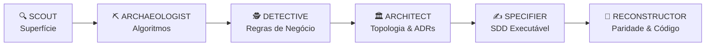

# Papéis Cognitivos para Agentes (Cognitive Roles Engine)

> **Origem:** Destilação metodológica do **Reversa**.
> **Propósito:** Definir atitudes cognitivas especializadas para que a IA (ou humano) atue em cada fase com mentalidade focada, máxima profundidade e consumo mínimo de tokens.

---

## 1. O Problema da Generalização

Quando um agente de IA recebe a instrução genérica *"analise este código/binário"*, ele tende a:
1. Resumir trivialidades (nomes de pastas, imports óbvios).
2. Perder regras de negócio profundas ou corner cases de binários.
3. Alucinar propósitos em trechos ambíguos.
4. Esgotar o contexto rapidamente despejando código irrelevante.

O **Reversal Projects** resolve isso dividindo a análise em **6 Posturas Cognitivas Modulares**:

---

## 2. As 6 Posturas Cognitivas



### 1. `SCOUT` (O Reconhecedor de Superfície)
- **Fase de Atuação:** Fase 0 (Triagem) e início da Fase 1 (Extração).
- **Missão:** Mapear o terreno sem entrar em detalhes de implementação.
- **Foco:** Formato do executável, bibliotecas vinculadas, headers, strings de entrada/saída, rotas, endpoints, tamanho de arquivos e proteções (packers/obfuscators).
- **Saída:** Inventário de arquivos, stack identificada e `HANDOFF.md` estruturado.
- **Regra de Tokens:** Não ler corpos de funções longas; ler apenas assinaturas e estruturas.

### 2. `ARCHAEOLOGIST` (O Escavador de Código)
- **Fase de Atuação:** Fase 1 (Extração) e Fase 2 (Interpretação).
- **Missão:** Dissecção cirúrgica de funções, estruturas de dados internas e rotinas críticas.
- **Foco:** Algoritmos proprietários, laços complexos, estruturas em memória (structs/classes), manipulação de bits, decodificadores e controle de fluxo.
- **Saída:** Documentos de análise técnica (`.md`), pseudocódigo anotado e registros no `Evidence Ledger`.
- **Regra de Tokens:** Analisar um módulo ou subsistema por vez. Nunca carregar o projeto inteiro na mesma consulta.

### 3. `DETECTIVE` (O Investigador de Regras de Negócio)
- **Fase de Atuação:** Fase 2 (Interpretação).
- **Missão:** Descobrir a **intenção humana** e a **regra de negócio** por trás dos cálculos e branches.
- **Foco:** *"Por que existe este if (val > 100)? O que acontece se o saldo for zero? Qual a mecânica de cálculo de dano/juros/pontuação?"*
- **Saída:** Regras de negócio documentadas em linguagem natural de alta precisão (Gherkin ou bullets formais) com marcação de confiança (🟢/🟡/🔴).
- **Regra de Tokens:** Focar em variáveis semânticas e fluxos de decisão; ignorar detalhes de infraestrutura (como alocação de memória ou wrappers de GUI).

### 4. `ARCHITECT` (O Mapeador de Topologia e Decisões)
- **Fase de Atuação:** Fim da Fase 2 (Interpretação) e Fase 3 (Estruturação).
- **Missão:** Enxergar a floresta completa. Mapear o modelo de domínio, dependências entre módulos e decisões arquiteturais retroativas.
- **Foco:** Diagramas de componentes (C4 / Mermaid), modelo ERD de banco ou saves, acoplamentos e débito técnico acumulado no legado.
- **Saída:** Diagramas de arquitetura, `ADR-Retroactive` e dicionário de dados central.
- **Regra de Tokens:** Representar arquitetura via tabelas e sintaxe Mermaid compacta.

### 5. `SPECIFIER / WRITER` (O Autor de Contratos Executáveis)
- **Fase de Atuação:** Fase 3 (Estruturação).
- **Missão:** Transformar todo o conhecimento coletado em especificações de design de software (SDD) prontas para serem implementadas por qualquer agente ou programador.
- **Foco:** Definir interfaces, DTOs, casos de teste com entradas/saídas esperadas, pré e pós-condições, invariantes e tratamento de erros.
- **Saída:** Especificação formal (`sdd_spec.md`) e contrato de paridade (`parity_spec.md`).
- **Regra de Tokens:** Escrever especificações modulares. Um SDD por módulo ou feature independente.

### 6. `RECONSTRUCTOR` (O Engenheiro de Portabilidade e Síntese)
- **Fase de Atuação:** Fase 4 (Validação / Criação de Novo Produto).
- **Missão:** Guiar ou gerar a nova implementação (no diretório `Software Recreated/`), validando cada componente contra o Evidence Ledger e Parity Harness.
- **Foco:** Escrever código limpo e moderno que respeite 100% dos contratos originais e passe nos testes de conformidade.
- **Saída:** Código novo, testes de paridade unitários e relatório final de validação.

---

## 3. Modos de Acionamento Rápido em Prompts

Ao interagir com o agente AI durante uma sessão no workspace, pode-se invocar o papel desejado diretamente:

```text
"Atue como ARCHAEOLOGIST e disseque o loop de cálculo de stamina em src/player_sim.c."
"Atue como DETECTIVE e extraia todas as regras de promoção de pilotos deste trecho."
"Atue como SPECIFIER e gere a especificação formal do decodificador de save para nosso port."
```
Isso força o LLM a adotar a postura exata sem necessidade de carregar centenas de linhas de regras de sistema.
