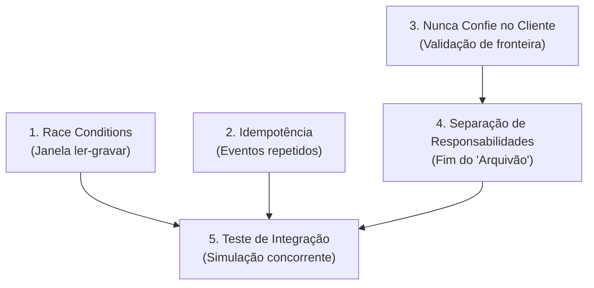

# Módulo Opcional: Teste, Resiliência e Segurança (Security & Resilience Engine)

> **Status:** 🛡️ **OPT-IN** (Acionado exclusivamente quando o usuário solicitar auditoria de segurança ou quando o projeto for avançar para código de produção/reconstrução em `Software Recreated/`).  
> **Filosofia:** Fundamentos sólidos de engenharia de software contra vulnerabilidades típicas de "vibe coding". Entenda primeiro, rode depois. Evite over-engineering: resolva concorrência e integridade com as ferramentas que você já tem (o próprio banco de dados) antes de adicionar complexidade de infraestrutura.

---

## 1. Quando Ativar Este Módulo

Este módulo permanece adormecido por padrão durante as análises de pura engenharia reversa para não inflar o contexto de tokens. Deve ser ativado nas seguintes situações:
1. **Solicitação Explícita:** Quando o usuário pedir: *"audite a segurança"*, *"verifique race conditions"*, ou *"prepare este código para produção"*.
2. **Fase de Síntese (`Software Recreated/`):** Durante a Fase 3 (Estruturação) e Fase 4 (Validação), ao implementar endpoints, pagamentos, estoques, autenticação ou rotinas concorrentes.

---

## 2. Os 5 Fundamentos de Engenharia & Resiliência



---

### Fundamento 1: Race Condition (Condição de Corrida)
> **O Sintoma:** Pedido duplicado, saldo negativo, estoque negativo, venda de produto inexistente.

#### O Conceito: 1 Pão, 2 Clientes
```
Cliente A (olha a cesta: tem 1 pão) ──> [ Cesta: 1 Pão Francês ] <── Cliente B (olha a cesta: tem 1 pão)
A atendente vende para os dois ao mesmo tempo. Alguém pagou por um pão que não existe.
```

#### Na Prática: A Janela Crítica Entre Ler e Gravar
- **Com Falha (Race Condition):**
  - Requisição A lê estoque: `1`
  - Requisição B lê estoque: `1`
  - Requisição A grava: `estoque = 0`
  - Requisição B grava: `estoque = -1` (ou vende sem estoque no banco)
- **Com Correção Atômica:**
  - Requisição A atualiza atomicamente: subtrai `1` onde `qtd > 0` (sucesso).
  - Requisição B tenta atualizar: nenhuma linha afetada $\rightarrow$ retorna imediatamente sem estoque.

#### A Armadilha do Over-Engineering: *"Boto um Redis na frente"*
Colocar Redis ou filas em memória para tentar resolver race condition traz mais problemas:
- O cache frequentemente fica milissegundos defasado em relação ao banco.
- O sistema decide com base em um estoque ou saldo que já mudou.
- Mais servidores, mais rede, mais pontos únicos de falha.
- **Princípio:** Não complique o simples. O banco de dados relacional que você já tem possui transações atômicas nativas comprovadas há 40 anos.

#### A Correção no Banco (Em Ordem de Preferência):
1. **Constraint Única (Unique Index):**
   ```sql
   CREATE UNIQUE INDEX idx_pedidos_checkout ON pedidos (checkout_id);
   ```
2. **Operação Atômica no `UPDATE`:**
   ```sql
   UPDATE estoque 
   SET qtd = qtd - 1 
   WHERE id = $1 AND qtd > 0;
   ```
   *(Verifique o número de linhas afetadas. Se for 0, o item acabou).*
3. **Lock Explícito de Linha (`FOR UPDATE`):**
   ```sql
   SELECT * FROM estoque WHERE id = $1 FOR UPDATE;
   -- Faz a lógica e commita a transação
   ```

*Nota:* Desabilitar botão no frontend previne cliques acidentais de usuários normais, mas **não** oferece nenhuma segurança contra múltiplos disparos de rede ou atacantes.

---

### Fundamento 2: Idempotência (Tolerância a Repetição)
> **O Sintoma:** O webhook do gateway de pagamento chega 2 vezes e libera o plano/créditos duas vezes.

#### O Cenário Real: Queda de Conexão ou Retentativa de Webhook
```
[ Gateway de Pagamento ]                      [ Seu Servidor (VPS / API) ]
           │                                                │
           ├─── Pagamento Aprovado (evt_1A2b) ────────────>│ (Processa e libera)
           │                                                │
           │<── Resposta (200 OK) demorou ou caiu a rede ───┤
           │                                                │
           ├─── Reenvio automático do MESMO evento ────────>│ [PREJUÍZO: Libera 2x!]
```

Todo gateway de pagamento e mensageria repete eventos não confirmados. Seu backend **DEVE** suportar receber o mesmo evento $N$ vezes sem gerar efeito colateral duplicado.

#### A Solução: O "Carimbo da Lotérica"
Se já foi carimbado como pago, não pode pagar de novo.

```
Tabela: EVENTOS_PROCESSADOS
[ event_id (Chave Primária) ] [ processado_em ]
[ evt_9Xk4                  ] [ 2026-10-27    ]
[ evt_1A2b                  ] [ 2026-10-28    ]
```

- **1ª Vez:** Chega `evt_1A2b` $\rightarrow$ Tenta inserir na tabela $\rightarrow$ Gravou com sucesso $\rightarrow$ Executa a liberação.
- **2ª Vez:** Chega `evt_1A2b` $\rightarrow$ Banco recusa imediatamente por violação de chave primária/única $\rightarrow$ Retorna `200/201 OK` e interrompe a execução.
- *Por que travar no banco e não com `if (!jaProcessou)` no código?* Porque duas requisições idênticas chegando no mesmo milissegundo passariam juntas pelo `if` (criando a Race Condition novamente).

#### Idempotência em Requisições de Cobrança / Criação
Quando o cliente envia uma ordem de cobrança:
```http
POST /api/checkout
Idempotency-Key: 7f3c9a2e-5b12-4c8d-9012-abcdef123456
```
- A chave de idempotência deve ser um **UUID v4 gerado uma única vez** pela ação do cliente (ao abrir o modal ou carregar a tela).
- **Nunca** use e-mail, CPF ou dados mutáveis como chave de idempotência.
- Se a rede oscilar e o cliente reenviar a mesma chave, o servidor detecta que a operação já existe e devolve a resposta cacheada sem efetuar nova cobrança.

---

### Fundamento 3: Nunca Confie no Cliente (Zero Trust de Fronteira)
> **O Sintoma:** Chaves de API vazadas no frontend, RLS (Row Level Security) desligado no Supabase/Firebase, cliente alterando o campo `preco` no payload do JSON.

#### Regras Inegociáveis de Fronteira:
1. **Preço e Regra de Negócio São do Servidor:** O frontend envia apenas `produto_id` e `quantidade`. O backend busca o preço unitário oficial na tabela de produtos.
2. **Segredos Ficam no Cofre (Backend):** Chaves com privilégio de escrita ou service role (`STRIPE_SECRET_KEY`, `DATABASE_URL`) **nunca** podem ser importadas em bundle de frontend ou expostas em variáveis com prefixo `NEXT_PUBLIC_` / `VITE_`.
3. **Autenticação Não é Autorização:** Saber *quem* é o usuário (`req.user.id`) não significa que ele possa alterar o recurso solicitado. Toda query deve verificar posse explícita:
   ```sql
   UPDATE documentos SET conteudo = $1 WHERE id = $2 AND proprietario_id = $3;
   ```

---

### Fundamento 4: Separação de Responsabilidades (Fim do "Arquivão")
> **O Sintoma:** Um único arquivo de 3.000 linhas (`server.js`, `app.py`, `MainForm.vb`) onde vivem rotas, regras de negócio, queries SQL, renderização de HTML e tratamento de erros. Ninguém tem coragem de mexer.

#### A Decomposição Cirúrgica:
- **Camada de Transporte / Controller:** Apenas recebe requisição, valida schema básico de entrada e repassa.
- **Camada de Domínio / Serviços:** Contém as regras puras de cálculo e negócio (sem saber se veio de HTTP, CLI ou fila).
- **Camada de Persistência / Repositório:** A única que conhece o banco de dados e executa SQL/queries.
- **Regra dos Limites Claros:** Cada função deve ter uma única razão para mudar.

---

### Fundamento 5: Testes de Integração & Simulação Concorrente
> **O Sintoma:** O código compila, passa em testes unitários simples com mocks ingênuos, mas quebra no primeiro minuto de tráfego real.

#### O que Deve Ser Testado Obrigatoriamente:
1. **Cenário Concorrente (Teste de Padaria):** Disparar 2 a 5 requisições assíncronas simultâneas (`Promise.all` ou threads) tentando comprar o último item em estoque. Exatamente 1 deve ter sucesso, as demais devem falhar com erro previsto.
2. **Cenário de Retentativa (Teste de Repetição):** Disparar o mesmo webhook com o mesmo payload duas vezes consecutivas. O efeito final no banco (saldo, liberação) deve ser aplicado apenas uma vez.

---

## 3. Biblioteca de Prompts de Auditoria (Prontos para Execução)

Quando este módulo for ativado, use os prompts padronizados abaixo para direcionar a IA:

### Prompt A: Detecção e Correção de Race Conditions
```markdown
Você é um engenheiro de software sênior revisando este código contra vulnerabilidades de concorrência.
Objetivo: encontrar e corrigir todas as race conditions do sistema.

1. Varra o código e liste todos os locais que fazem o padrão "ler, decidir e depois gravar" (Read-Modify-Write).
2. Para cada ocorrência, explique exatamente o que acontece quando duas requisições simultâneas atingem essa janela de tempo.
3. Proponha a correção direta no banco de dados na ordem estrita de preferência:
   a) Constraint única (Unique Index)
   b) Operação atômica em um único UPDATE (com cláusula WHERE protetiva)
   c) Lock de linha (SELECT FOR UPDATE)
4. REGRA: Não proponha Redis, filas em memória ou locks de processo se o próprio banco de dados relacional resolver.
5. Escreva um teste de integração que dispara 2 requisições concorrentes simulando o cenário para comprovar a correção.
```

### Prompt B: Blindagem de Idempotência e Webhooks
```markdown
Você é um engenheiro sênior especialista em resiliência e sistemas de pagamento.
Objetivo: garantir que todo webhook e endpoint crítico aceite repetição sem duplicar efeitos.

1. Mapeie todos os endpoints que recebem webhooks externos ou processam mutações financeiras/estoque.
2. Crie uma estratégia de idempotência com tabela de eventos processados (ID único como chave primária).
3. Verifique a validação de assinatura criptográfica de todos os webhooks recebidos.
4. Para endpoints de mutação acionados pelo usuário, implemente o suporte ao cabeçalho "Idempotency-Key" com UUID.
5. Escreva um teste automatizado simulando:
   a) O mesmo evento entregue 2 vezes consecutivas.
   b) Dois eventos idênticos chegando no mesmo milissegundo.
```

### Prompt C: Auditoria Zero-Trust e RLS
```markdown
Você é um auditor de segurança de aplicações.
Objetivo: auditar o código contra vazamento de privilégios e confiança cega no cliente.

1. Identifique se existe qualquer variável de ambiente sensível ou chave mestra exposta para o cliente/frontend.
2. Analise todas as queries de escrita/leitura e verifique se a autorização (propriedade do recurso) está validada no backend.
3. Verifique se o cliente envia dados sensíveis de cálculo (como preços, descontos ou permissões) em vez de apenas identificadores.
```
