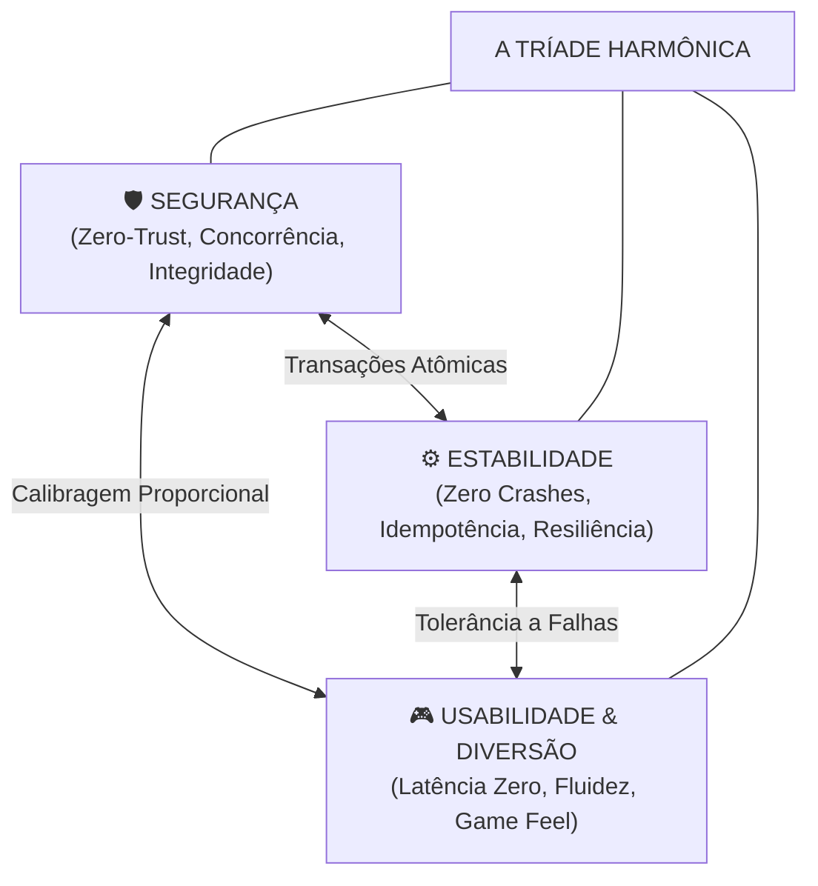
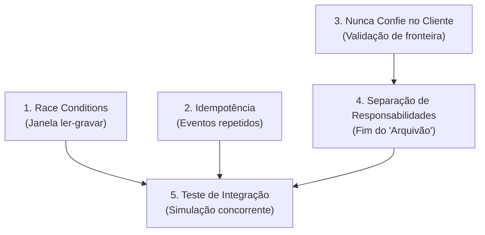

# Módulo Opcional: Teste, Resiliência e Segurança (Security & Resilience Engine)

> **Status:** 🛡️ **OPT-IN** (Acionado sob demanda para auditoria de segurança ou durante a síntese de novos produtos em `Software Recreated/`).  
> **Filosofia Central:** O ajuste fino entre **Segurança, Estabilidade e Usabilidade/Diversão** é a verdadeira essência da engenharia. A modernização por segurança é indispensável para eliminar vulnerabilidades de código legado ou código gerado por IA, mas o propósito existencial do software — a **diversão** (em jogos) e a **fluidez de execução** (em aplicativos) — deve ser preservado de forma inegociável.

---

## 1. A Tríade Harmônica: O Ajuste Fino Proporcional

Segurança cega destrói produtos. Um sistema 100% seguro que ninguém consegue usar é inútil; um jogo ultra-protegido com lag de 200ms no pulo do personagem perde o jogador no primeiro minuto.



### O Mandamento da Modernização Segura:
> **"A segurança atua por baixo do capô; a experiência na superfície permanece pura, ágil e fiel à sua alma."**

---

## 2. Calibragem Proporcional por Perfil de Produto

A técnica de segurança é universal, mas sua aplicação prática deve se ajustar ao objetivo de cada tipo de software:

---

### A. Perfil Game (Jogos & Simulação): A Diversão e o *Game Feel* São Sagrados
Em jogos, latência é a morte da experiência. A taxa de quadros (60 FPS / 16.6ms por frame) e o tempo de resposta do controle não podem ser sacrificados por burocracias de validação síncrona.

| O que a Segurança NUNCA pode fazer em Jogos | Onde a Modernização de Segurança DEVE Atuar |
|---|---|
| ❌ Bloquear a thread principal de render/física com escrita em disco ou chamadas de rede síncronas. | ✅ **Saves Atômicos em Background:** Gravar saves em arquivo temporário (`save.tmp`) e fazer swap atômico do SO em thread assíncrona para evitar corrupção se a energia acabar. |
| ❌ Alterar fórmulas de física, tempos de pulo ou RNG em single-player para "evitar trapaças locais". | ✅ **Memory Safety:** Substituir arrays C brutos propensos a buffer overflow por structs tipadas e seguras sem penalidade de runtime. |
| ❌ Adicionar delays artificiais de verificação em menus rápidos ou trocas de tela. | ✅ **Sanitização de Assets:** Validar cabeçalhos de arquivos de mods/texturas externas para impedir execução arbitrária de código (RCE). |
| ❌ Forçar login síncrono ou DRM agressivo que impeça o jogo de rodar offline quando aplicável. | ✅ **Multiplayer com Autoridade de Servidor:** No multiplayer, o servidor valida o estado final (reconciliação), mas o cliente faz previsão local (*client-side prediction*) para manter a resposta imediata. |

---

### B. Perfil App (Aplicativos Mobile, Desktop & Web): A Execução e a Fluidez São Soberanas
Em aplicativos, o usuário exige que a ação aconteça instantaneamente. Telas travadas com spinners infinitos (*ANR - Application Not Responding*) destroem a retenção.

| O que a Segurança NUNCA pode fazer em Apps | Onde a Modernização de Segurança DEVE Atuar |
|---|---|
| ❌ Congelar a interface gráfica do usuário enquanto aguarda resposta de rede ou banco. | ✅ **Validação Otimista:** A interface reage imediatamente à ação do usuário; validação de token e assinatura ocorre assincronamente com rollback gracioso se houver rejeição. |
| ❌ Descartar dados digitados offline pelo usuário por falta de conexão imediata com o servidor. | ✅ **Armazenamento Seguro Local:** Persistência em SQLite criptografado (SQLCipher) ou Keystore/Keychain do sistema operacional, sincronizando com idempotência ao reconectar. |
| ❌ Solicitar permissões abusivas de sistema logo no primeiro lançamento sem contexto claro. | ✅ **Zero-Trust no Backend:** O cliente envia intenções; o servidor calcula preços, permissões e regras, nunca confiando cegamente no payload recebido. |

---

### C. Perfil Legacy System (Corporativo & Servidores): A Integridade Transacional é a Bússola
Em sistemas legados de gestão, finanças ou produção, um centavo errado ou uma transação perdida gera prejuízo legal.

| O que a Segurança NUNCA pode fazer em Legados | Onde a Modernização de Segurança DEVE Atuar |
|---|---|
| ❌ Mudar regras históricas de arredondamento fiscal ou cálculos consolidados em nome de "modernização cosmética". | ✅ **Queries Parametrizadas:** Substituição imediata de toda concatenação de strings SQL por consultas parametrizadas (eliminação definitiva de SQL Injection). |
| ❌ Aplicar locks pessimistas de tabela inteira (`LOCK TABLE`) que paralisam a empresa em horários de pico. | ✅ **Operações Atômicas de Linha:** Uso de `UPDATE ... WHERE qtd > 0` e índices exclusivos para matar race conditions sem travar outros registros. |
| ❌ Exigir refatoração total ("Big Bang") com semanas de parada operacional. | ✅ **Fatias Verticais (Strangler Fig):** Blindar os endpoints críticos um por um com testes de paridade oráculo vs candidato. |

---

## 3. Os 5 Fundamentos de Engenharia & Resiliência



---

### Fundamento 1: Race Condition (Condição de Corrida)
> **O Sintoma:** Pedido duplicado, saldo negativo, estoque negativo, venda de produto inexistente, savegame corrompido por escritas concorrentes.

#### O Conceito: 1 Pão, 2 Clientes
```
Cliente A (olha a cesta: tem 1 pão) ──> [ Cesta: 1 Pão Francês ] <── Cliente B (olha a cesta: tem 1 pão)
A atendente vende para os dois ao mesmo tempo. Alguém pagou por um pão que não existe.
```

#### Na Prática: A Janela Crítica Entre Ler e Gravar
- **Com Falha (Race Condition):**
  - Requisição A lê estoque: `1`
  - Requisição B lê estoque: `1`
  - Requisição A grava: `estoque = 0`
  - Requisição B grava: `estoque = -1` (venda ilegal gerada)
- **Com Correção Atômica:**
  - Requisição A atualiza atomicamente: subtrai `1` onde `qtd > 0` (sucesso).
  - Requisição B tenta atualizar: 0 linhas afetadas $\rightarrow$ retorna imediatamente que esgotou.

#### A Armadilha do Over-Engineering: *"Boto um Redis na frente"*
Colocar Redis ou filas em memória para tentar resolver race condition traz complexidade acidental:
- O cache frequentemente fica milissegundos defasado em relação ao banco.
- O sistema decide com base em um estoque ou saldo que já mudou.
- Mais servidores, mais rede, mais pontos únicos de falha.
- **Princípio:** O banco de dados relacional que você já tem possui transações atômicas nativas comprovadas há décadas. Use-as primeiro.

#### A Correção no Banco (Em Ordem de Preferência):
1. **Constraint Única (Unique Index):**
   ```sql
   CREATE UNIQUE INDEX idx_pedidos_checkout ON pedidos (checkout_id);
   ```
2. **Operação Atômica no `UPDATE`:**
   ```sql
   UPDATE estoque 
   SET qtd = qtd - 1 
   WHERE id = $1 AND qtd > 0;
   ```
3. **Lock Explícito de Linha (`FOR UPDATE`):**
   ```sql
   SELECT * FROM estoque WHERE id = $1 FOR UPDATE;
   ```

---

### Fundamento 2: Idempotência (Tolerância a Repetição)
> **O Sintoma:** O webhook do gateway de pagamento repete o evento e libera créditos ou produtos 2 vezes.

#### O Cenário Real: Retentativas Automáticas de Rede
Todo gateway de pagamento, serviço de mensageria ou cliente móvel em rede instável repete eventos quando a resposta demora alguns milissegundos. Seu backend **deve** tolerar receber o mesmo evento $N$ vezes sem duplicar efeitos colaterais.

#### A Solução: O "Carimbo da Lotérica"
Se já foi carimbado como pago, não pode pagar de novo.

```
Tabela: EVENTOS_PROCESSADOS
[ event_id (Chave Primária) ] [ processado_em ]
[ evt_9Xk4                  ] [ 2026-10-27    ]
[ evt_1A2b                  ] [ 2026-10-28    ]
```

- **1ª Vez:** Chega `evt_1A2b` $\rightarrow$ Tenta inserir na tabela $\rightarrow$ Inseriu com sucesso $\rightarrow$ Executa a liberação.
- **2ª Vez:** Chega `evt_1A2b` $\rightarrow$ Banco recusa imediatamente por violação de chave primária $\rightarrow$ Retorna `200/201 OK` e para imediatamente.
- *Por que travar no banco e não com `if (!jaProcessou)` no código?* Porque duas requisições idênticas chegando simultaneamente passariam juntas pelo `if`.

#### Idempotência em Requisições de Criação/Cobrança
```http
POST /api/checkout
Idempotency-Key: 7f3c9a2e-5b12-4c8d-9012-abcdef123456
```
- A chave de idempotência deve ser um **UUID v4 gerado uma única vez** pela ação do usuário.
- **Nunca** use e-mail, CPF ou dados mutáveis como chave.
- Se a rede cair no meio e o cliente reenviar a mesma chave, o servidor devolve a resposta cacheada sem efetuar nova cobrança.

---

### Fundamento 3: Nunca Confie no Cliente (Zero-Trust de Fronteira)
> **O Sintoma:** Chaves de API vazadas no frontend, RLS desligado, usuário alterando parâmetros de preço no payload.

#### Regras Inegociáveis de Fronteira:
1. **Preço e Regra de Negócio São do Servidor:** O frontend envia apenas identificador e quantidade; o cálculo final do total é soberania do backend.
2. **Segredos Ficam no Cofre (Backend):** Chaves com privilégio mestre (`SERVICE_ROLE`, `SECRET_KEY`) nunca podem estar em bundles de frontend ou clientes de jogos.
3. **Autenticação Não é Autorização:** Saber quem é o usuário não significa que ele possa alterar o recurso. Toda query deve verificar posse explícita:
   ```sql
   UPDATE documentos SET conteudo = $1 WHERE id = $2 AND proprietario_id = $3;
   ```

---

### Fundamento 4: Separação de Responsabilidades (Fim do "Arquivão")
> **O Sintoma:** O monólito de 3.000 linhas onde vivem queries, regras e UI misturadas que ninguém consegue testar ou refatorar com segurança.

- **Camada de Transporte / Controller / Input:** Apenas recebe dados, valida schema de entrada e delega.
- **Camada de Domínio / Serviços / Core:** Contém a regra de negócio pura (ou game loop matemático), sem saber se veio de HTTP, CLI ou savegame.
- **Camada de Persistência / I/O:** A única que fala diretamente com banco de dados, arquivos ou rede.

---

### Fundamento 5: Testes de Integração & Simulação Concorrente
> **O Sintoma:** Testes unitários com mocks ingênuos passam, mas o software falha sob tráfego ou cliques simultâneos.

#### Testes Obrigatórios de Resiliência:
1. **Cenário Concorrente (Teste da Padaria):** Disparar 2 a 5 requisições assíncronas simultâneas disputando o último recurso disponível. Exatamente 1 deve ter sucesso; as demais devem receber erro controlado.
2. **Cenário de Retentativa de Evento:** Disparar o mesmo webhook com o mesmo payload duas vezes consecutivas. O efeito final deve ser aplicado exatamente uma vez.
3. **Cenário de Queda Repentina (Power Cut / Crash Test):** Simular encerramento abrupto do processo durante a gravação de estado ou savegame para assegurar que nenhum arquivo fica corrompido em 0 bytes.

---

## 4. Biblioteca de Prompts de Auditoria e Remediação

Quando este módulo for acionado, utilize os prompts especializados abaixo:

### Prompt A: Detecção e Correção de Race Conditions
```markdown
Você é um engenheiro de software sênior revisando este código contra vulnerabilidades de concorrência.
Objetivo: encontrar e corrigir todas as race conditions do sistema sem comprometer usabilidade ou throughput.

1. Varra o código e liste todos os locais que fazem o padrão "ler, decidir e depois gravar" (Read-Modify-Write).
2. Para cada ocorrência, explique exatamente o que acontece quando duas requisições simultâneas atingem essa janela de tempo.
3. Proponha a correção direta no banco de dados na ordem estrita de preferência:
   a) Constraint única (Unique Index)
   b) Operação atômica em um único UPDATE (com cláusula WHERE protetiva)
   c) Lock de linha (SELECT FOR UPDATE)
4. REGRA ANTI-OVERENGINEERING: Não proponha Redis, filas em memória ou locks de processo se o próprio banco de dados resolver.
5. Escreva um teste de integração que dispara 2 requisições concorrentes simulando o cenário para comprovar a correção.
```

### Prompt B: Blindagem de Idempotência e Webhooks
```markdown
Você é um engenheiro sênior especialista em resiliência e sistemas de pagamento.
Objetivo: garantir que todo webhook e endpoint crítico aceite repetição sem duplicar efeitos.

1. Mapeie todos os endpoints que recebem webhooks externos ou processam mutações financeiras/estoque.
2. Crie uma estratégia de idempotência com tabela de eventos processados (ID único como chave primária).
3. Verifique a validação de assinatura criptográfica de todos os webhooks recebidos.
4. Para endpoints de mutação acionados pelo usuário, implemente o suporte ao cabeçalho "Idempotency-Key" com UUID.
5. Escreva um teste automatizado simulando:
   a) O mesmo evento entregue 2 vezes consecutivas.
   b) Dois eventos idênticos chegando no mesmo milissegundo.
```

### Prompt C: Ajuste Fino em Jogos (Segurança sem Matar o Game Feel)
```markdown
Você é um engenheiro de jogos sênior especialista em performance e arquitetura de engines.
Objetivo: modernizar a segurança e estabilidade deste código de jogo sem degradar a diversão, a física ou o frame rate.

1. Identifique se existe qualquer operação de disco, alocação excessiva ou chamada síncrona dentro da thread do game loop.
2. Isole as rotinas de save/load em um pipeline assíncrono atômico (escrita em arquivo temporário + swap atômico do SO).
3. Audite arrays e buffers C/C++ propensos a overflow sem adicionar bounds checking pesado em loops críticos de física.
4. Garanta que o RNG determinístico e a física original permaneçam 100% idênticos em paridade comportamental.
```

### Prompt D: Ajuste Fino em Aplicativos (Segurança sem Matar a Execução)
```markdown
Você é um arquiteto de software mobile/desktop focado em UX de alta fluidez e segurança.
Objetivo: aplicar segurança de fronteira sem travar a interface do usuário (Zero ANR).

1. Identifique qualquer chamada bloqueante de I/O na main thread de renderização da UI.
2. Implemente padrão de UI otimista com reconciliação assíncrona para ações de mutação.
3. Assegure que dados digitados offline sejam salvos localmente em container seguro antes da tentativa de envio à nuvem.
4. Audite variáveis de ambiente sensíveis garantindo que segredos não vazem para o cliente.
```
