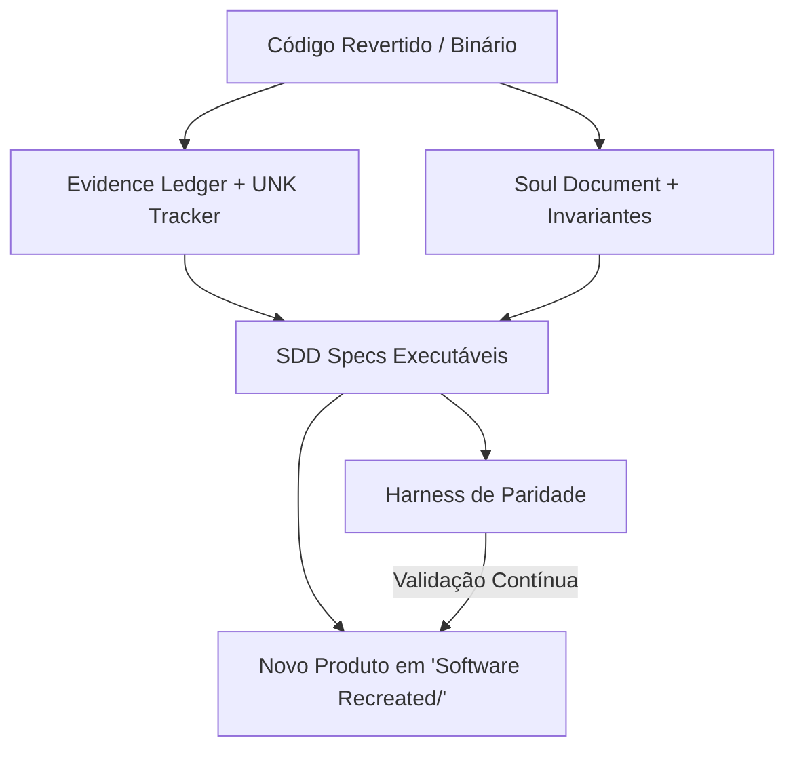

# Motor de Síntese e Migração (Synthesis & Modernization Engine)

> **Origem:** Fusão da Reconstrução Baseada em Evidências (**REA**) com o Catálogo de Migração e Paradigmas (**Reversa**).
> **Propósito:** Definir o caminho de transformação de um software legado (revertido) em um produto novo, moderno, testável e escalável em `Software Recreated/`.

---

## 1. O Ciclo da Síntese: Do Legado ao Novo Produto

A engenharia reversa só atinge seu valor máximo quando o conhecimento extraído permite atualizar ou recriar o software.

---

## 2. As 4 Estratégias de Transformação

Escolha a estratégia adequada na Fase 0 (Triagem) ou Fase 3 (Estruturação):

### A. Clean-Room Reimplementation (Reescrita Limpa Guiada por Spec)
- **Quando usar:** O legado está em linguagem morta ou muito amarrada a frameworks antigos (ex: Delphi 7, VB6, Visual Basic .NET 2.0, assembly 65816 do SNES), mas você deseja um produto moderno (ex: C# .NET 9, Rust, TypeScript, Python, Go, Godot/Unity).
- **Como funciona:** O desenvolvedor ou IA lê **apenas** a especificação (`SDD`) e o `Evidence Ledger`, sem copiar código sujo do legado. Escreve a implementação do zero seguindo Clean Architecture / Hexagonal.
- **Garantia:** O `Parity Harness` testa as saídas com as entradas extraídas do legado.

### B. Strangler Fig (Migração Incremental / Por Fatias Verticais)
- **Quando usar:** Sistemas grandes com banco de dados ou regras de negócio massivas que não podem ser reescritos de uma vez.
- **Como funciona:** Substitui-se um subsistema ou tela de cada vez. Cria-se um adaptador/façade entre o legado e o novo módulo até que o legado seja totalmente drenado.
- **Garantia:** Cada fatia vertical possui sua própria `Parity Spec`.

### C. Binary Wrapper / Hybrid Bridge (Ponte Híbrida)
- **Quando usar:** O legado possui rotinas de altíssima complexidade (ex: motor de simulação matemática, descompactador proprietário) cuja reescrita imediata tem alto risco de bugs.
- **Como funciona:** O binário original compilado (DLL, `.so`) é encapsulado via FFI (P/Invoke no C#, ctypes/CFFI no Python, N-API no Node.js). A nova interface moderna consome a DLL original enquanto o restante do produto é reconstruído. Posteriormente, a DLL pode ser substituída módulo a módulo.

### D. Direct Port / Native Target (Port Direto de Plataforma)
- **Quando usar:** Jogos clássicos ou utilitários para plataformas obsoletas (SNES, J2ME, Win16) que serão portados diretamente para engines atuais (Godot, Raylib, SDL2, Flutter).
- **Como funciona:** Reimplementação 1:1 das rotinas de game loop, substituindo chamadas de hardware antigas (DMA, VRAM, interrupções) pelas APIs modernas correspondentes.

---

## 3. Matriz de Transformação de Paradigmas

| Paradigma no Legado | Típico Em | Paradigma Alvo Recomendado | Padrão Arquitetural Alvo |
|---|---|---|---|
| **Procedural Monolítico** | C antigo, COBOL, scripts, assembly | **Modular Funcional / OO Puro** | Ports limpos, Ports orientados a funções puras |
| **GUI-Coupled (Code-Behind)** | VB6, WinForms (.NET 2.0), Delphi VCL | **MVVM / MVC / Clean Architecture** | Separação rigorosa de Core de Negócio vs UI |
| **Spaghetti Loop com Flags Globais** | Jogos antigos, J2ME, scripts de simulação | **State Machine / Data-Driven / ECS** | Máquina de estados explícita, entidades desacopladas |
| **Direct DB Query / Sprawled SQL** | VB.NET, PHP antigo, ASP | **Repository Pattern + CQRS** | Abstração de persistência, schemas versionados |

---

## 4. O Princípio da Decomposição Atômica

Para economizar contexto e tokens na hora de construir o novo produto:
1. Nunca peça para uma IA implementar "o sistema todo".
2. Implemente na ordem:
   - **Camada 1: Utilitários & Parsers Puros** (RNG, criptografia, formato de arquivo, compressão). Validar com Parity Harness.
   - **Camada 2: Entidades e Modelo de Domínio** (Structs, Enums, DTOs).
   - **Camada 3: Motor de Regras / Simulação** (Algoritmos de negócio, mecânicas).
   - **Camada 4: Persistência & I/O** (Bancos, arquivos de save, rede).
   - **Camada 5: Interface de Usuário / API** (Telas, controllers, apresentação).
